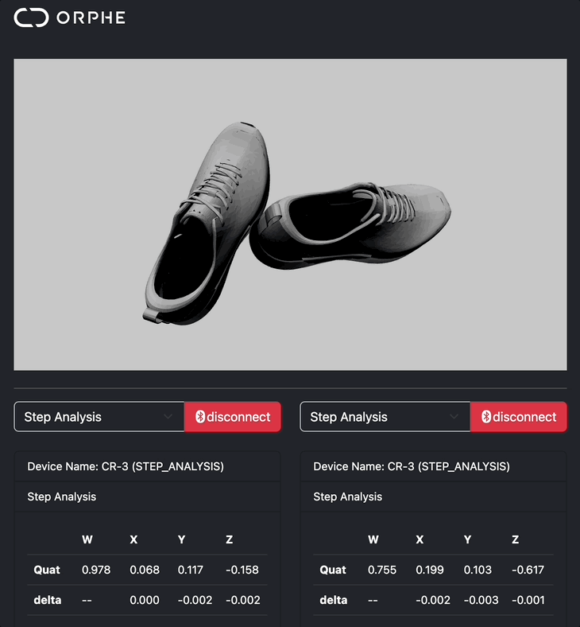

# Sensor Dashboard

ORPHE CORE / ORPHE INSOLE を最大2台同時に接続し、センサー値と靴の3D姿勢を左右カラムで表示するダッシュボードです。
旧 ORPHE-CORE.js の `VIEW` と旧 ORPHE-INSOLE.js の `sensor-dashboard` を統合しています。

## できること

- スロットごとに `ORPHE CORE` / `ORPHE INSOLE` を選択（変更するとページを再読み込みします）
- 共通: 加速度 [G]・角速度 [dps]・クォータニオン・オイラー角、タイムスタンプ/パケット番号、STATUS（バッテリー・取り付け位置・レンジ）
- 共通: p5.js（WEBGL）+ toxiclibs による靴モデルの3D表示（`on('quat')` で回転）
- CORE のみ: notification type の選択（`STEP_ANALYSIS` / `SENSOR_VALUES` / `STEP_ANALYSIS_AND_SENSOR_VALUES`）、Gait / Stride（Foot Angle）/ Pronation（Landing Impact）/ Delta の表示、`Reset Attitude`（`commands.resetAttitude()`）
- INSOLE のみ: 圧力 6ch の表示、`profile.device_information.mount_position` による左右の自動割り当て

## 左右の割り当て

1. 各スロットの `Left Foot` / `Right Foot` セレクトで手動指定した値を優先します。
2. 未指定の場合、INSOLE は `mount_position` の bit0（0=左, 1=右）、CORE はスロット番号（DEVICE 1=左, DEVICE 2=右）で決めます。

## 使い方

1. Web Bluetooth 対応ブラウザ（Chrome など）で、ローカルサーバーまたは GitHub Pages から `SENSOR-DASHBOARD/` を開きます。
2. 各スロットのデバイス種別を選びます（URL クエリ `?slot0=core&slot1=insole` でも指定できます）。
3. CORE の場合は notification type を選び、`DEVICE 1` / `DEVICE 2` ボタンで接続します。もう一度押すと切断します。

## 使用ライブラリ

- [ORPHE-CORE-INSOLE.js](https://github.com/Orphe-OSS/ORPHE-CORE-INSOLE.js)（`OrpheCoreInsole`。CORE は `coreProfile`、INSOLE は `insoleProfile`）
- `../assets/js/device-slot.js`、p5.js、toxiclibs.js
